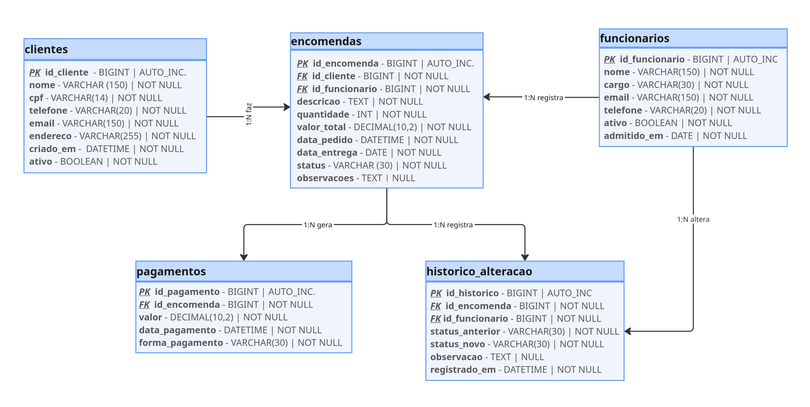

# UniBolos

Sistema de gerenciamento de encomendas para uma confeitaria, desenvolvido com Java e Spring Boot.

## Sobre o projeto

O UniBolos tem como objetivo centralizar e organizar o gerenciamento de encomendas de uma confeitaria, facilitando o acompanhamento dos pedidos, dos clientes, dos pagamentos e dos prazos de entrega.

A proposta é reduzir problemas causados pelo controle manual de informações, como divergências nos pedidos, atrasos na produção e dificuldade no acompanhamento dos pagamentos.

## Funcionalidades

- Cadastro e gerenciamento de clientes.
- Registro e acompanhamento de encomendas.
- Gerenciamento de funcionários.
- Registro e controle de pagamentos.
- Histórico de alterações de status das encomendas.

## Tecnologias utilizadas

- Java 21
- Spring Boot
- Spring Data JPA
- Spring Web
- PostgreSQL
- Flyway
- Maven

## Arquitetura

O UniBolos adotará uma **arquitetura monolítica em camadas, organizada por domínio (feature)**. A aplicação será executada como um único serviço Spring Boot, enquanto o código de cada área do negócio ficará agrupado por domínio, como clientes, encomendas, funcionários, pagamentos e histórico.

### Justificativa

Essa arquitetura atende ao fluxo integrado da confeitaria: uma encomenda depende de um cliente e de um funcionário e pode ter pagamentos e registros de histórico associados. Manter essas operações em uma única aplicação facilita a consistência dos dados e a comunicação entre as partes do sistema.

O escopo atual é relativamente direto, centrado no cadastro e acompanhamento dessas informações. Um monólito em camadas oferece separação clara de responsabilidades sem acrescentar o custo operacional de distribuir o sistema em vários serviços. A organização por domínio também ajuda uma equipe pequena, trabalhando em conjunto com Java e Spring Boot, a localizar e alterar o código de cada funcionalidade sem espalhar suas regras por todo o projeto.

### Organização do código

Cada domínio terá seus componentes agrupados em `internal/<dominio>`, separando as responsabilidades em pacotes:

```text
uniesp.unibolos
├── UnibolosApplication.java
└── internal
    ├── cliente
    │   ├── controller       # endpoints HTTP
    │   ├── service          # regras e casos de uso
    │   ├── repository       # acesso a dados com Spring Data JPA
    │   ├── dto              # dados de entrada e saída da API
    │   └── entity           # entidades e mapeamentos JPA
    ├── encomenda
    │   ├── controller
    │   ├── service
    │   ├── repository
    │   ├── dto
    │   └── entity
    ├── funcionario
    ├── pagamento
    └── historico
```

Os domínios menores podem começar apenas com os componentes de que precisam. As dependências seguem o fluxo da aplicação: controllers recebem requisições e chamam services; services aplicam as regras do negócio e usam repositories para persistir entities; DTOs definem os dados expostos pela API, evitando usar entidades JPA diretamente como contrato HTTP. Regras compartilhadas, como tratamento de erros, podem ficar em um pacote comum quando houver necessidade real.

Essa estrutura descreve a organização prevista para o projeto. Atualmente, o código contém a classe principal e as entidades JPA; controllers, services, repositories e DTOs serão adicionados conforme as funcionalidades forem implementadas.

## Modelo de dados

O diagrama abaixo representa a estrutura de entidades e seus relacionamentos no sistema.




## Status do projeto

Em desenvolvimento.
